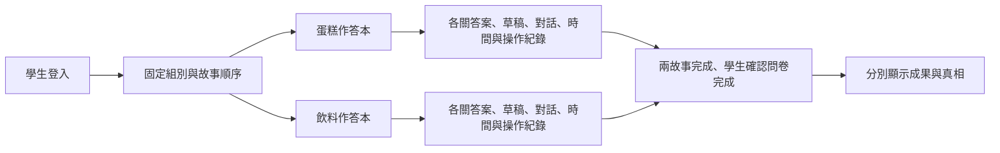

# 蛋糕與飲料的共用流程

## 2026-10-27 人物照片接線

使用者已提供 media/cake 與 media/drink 人物素材。cake 使用 char_1.jpg 至 char_6.jpg；drink 六人依序使用 ref_zhou_yixing.jpeg、ref_bai_erqing.jpeg、ref_gu_sanyao.jpeg、ref_han_sicheng.jpeg、ref_xia_wuqiao.jpeg、ref_tang_liuya.jpeg。更新 characters[].image 僅為補圖片地址，不改角色文案、配分或作答；介紹、證詞、訊問與小頭像均從角色資料取圖，舊單故事保留原有資源。林知遠、場景與物件素材不列入六位可訊問角色。未裁改原檔；網頁沿用卡片裁切，姓名對應以使用者的檔名為依據，未逐一對影片核驗。

缺片測試副本仍不複製真實影片，但會複製兩故事圖片，避免驗證缺影片時連人物圖片一起404。

## 2026-10-27 調查須知整併

完整計分、觀看／訊問／分類步驟與自動保存說明，移到 consent 的 Picture1 流程圖下，取代原簡短說明；操作列圖片保留在說明下方。雙故事人物介紹的「開始調查」與倒數到期直接進第一關影片，不再顯示獨立須知頁。伺服器仍沿用原有 onboarding 進度契約，前端依序保存 step 2／3；重整時若伺服器回傳 step 2（含舊進度或離線期間到時），先完成 step 3 再顯示遊戲。未改資料表、影片完成門檻、舊單故事須知或作答計時。

飲料六個角色的 image 仍為空，專案只有飲料影片，未找到可確認人物對應的獨立照片。本輪未生成或借用蛋糕照片。

## 2026-10-18 流程調整

本輪使用者確認 lab 是目前 Windows／XAMPP，現有 Apache 8081 的 DocumentRoot 就是本專案；無須另建站點。流程改為實驗說明 → 前測 → 第一故事 → 強制休息五分鐘 → 第二故事 → 後測。前後測沿用 `SURVEYCAKE_PRE_URL`／`SURVEYCAKE_POST_URL` 與 `ck_surveys`，完成仍是學生自我回報；後測入口檢查兩故事均完成，完成後開放成果。

實驗組第一故事只顯示本關及累積分類分數，不揭露解析、不產生 AI 評語；第二故事沿用原得分、解析及 AI 回饋。控制組維持原本揭露時機。第一／第二按實際作答順序，不綁定蛋糕或飲料。

使用者確認「一分鐘」指每個故事開頭六人角色介紹，不是每關六人發言。進入介紹時以既有 `ck_story_events` 保存起始秒數，重整續算，到時自動進入調查須知；保留原手動前進按鈕。說明頁讀取狀態不啟動倒數。五分鐘休息沿用既有伺服器門檻，兩組與兩種故事順序均已驗證；倒數結束開放開始按鈕。

本輪沒有修改資料表、環境密鑰、真實學生答案或新增服務。飲料六支影片在目前磁碟已存在，下方舊交接的缺檔狀態已過時，但本輪未驗證全部影片內容。後續已修正兩項缺片測試：改用獨立暫存站點，保留缺片阻擋斷言，另以一秒測試影片驗證實播後前進；不移動lab影片。完整測試仍受原建刪資料庫限制，故未提交／合併／推送，不能宣稱正式施測驗收完成。

目前程式已在工作區實作，沒有啟用新學生分派或同步到原試玩站。飲料配分已依使用者核可定案：逐人判定標籤優先，缺漏才用附錄；矛盾說明保留待老師修訂。影片與照片待補。既有帳號維持原單故事流程。

## 資料怎麼保存



沿用同一資料庫。`ck_story_studies` 像學生資料夾封面，記錄四種分組代碼、首次分派時間與目前進行第幾個故事。`ck_story_runs` 像裡面兩本作答本，各自有唯一編號（run_id），避免兩份第一關混在一起。

`ck_story_work` 保存各關影片進度、伺服器計時、最新草稿、凍結答案及回饋。`ck_story_messages` 保存對話、AI 成功狀態、模型與回覆時間。`ck_story_events` 追加保存草稿版本、影片進度、階段切換、提交與完成時間，重送相同操作不重複列計。`ck_story_allocation` 以資料庫鎖依序分派；同時登入也只取得一個序號。

主方案是新增資料表，保留舊學生的 `ck_*` 紀錄。備案是直接修改所有舊表，但會增加搬動歷史作答的風險；因此這次選新增表。代價是教師匯出時必須查新表；現有舊版匯出工具不會自動包含新故事，尚無新教師匯出介面。

故事內容放在伺服器限定的 `api/stories/`，回合固定記錄內容版本。前端只收到目前關卡可公開的材料，教師判定與未來劇情不隨初始狀態傳送。計分在伺服器完成，不能靠修改畫面指定分數。

## 維護與啟用條件

- 保持現有 `.env`，不要覆寫金鑰或變更既有資料庫。新增表指令：`php api/tools/install_stories.php`；只在已設定的資料庫建立新表，不建刪資料庫。
- `STORY_STUDY_ENABLED=0` 是預設值。設成 1 才讓尚無舊回合的新學生進入雙故事；既有雙故事學生即使停用分派仍可續作。
- `STORY_STUDY_KEY=cake-drink-v1` 決定這次研究的分派序列；測試使用獨立 `test_` 序列，不能用正式序列試登入。
- 飲料影片位置：`media/drink/intro-L1.mp4` 至 `intro-L6.mp4`。每關缺檔時保留影片頁顯示待補，不能跳過。人物照片缺少時使用姓名，之後在內容版本的 `characters[].image` 指定資源。
- 已核可的判準差異處理見 [決議紀錄](open-questions.md)。影片補齊、全套測試及正式環境核心流程驗證之前，不能宣稱可正式施測；教師說明文字的矛盾仍保留待修訂。
- 問卷由老師處理；成果頁門檻只記錄學生自行確認，不驗證外部問卷平台是否收到答案。
- Apache 必須允許 `.htaccess`（既有部署要求），`api/stories/.htaccess` 禁止直接下載教師內容。PHP 測試伺服器必須使用 `tests/router.php`；不可直接用未保護路徑的裸靜態伺服器公開專案。
- 沒有新增套件或外部服務。AI 沿用既有供應商；兩個故事增加關卡及對話機會，實際 AI 費用與等待時間尚未量測。

## 本輪測試

在指定 `idealightsdg_cake` 使用合成帳號、獨立分派序列、獨立 PHP 連接埠與本機假 AI；結束只刪除測試建立的帳號及其從屬資料。不呼叫付費 AI，不建立／刪除其他資料庫。

```powershell
$env:TEST_PHP_BINARY='C:/Users/User/AppData/Local/Temp/idealight-windows-bb789a74/php82/php.exe'
$env:PLAYWRIGHT_MODULE='C:/Users/User/AppData/Local/Temp/idealight-windows-bb789a74/site/tests/node_modules/playwright/index.mjs'
node --test --test-concurrency=1 tests/config.test.mjs tests/rank.test.mjs tests/media.test.mjs tests/test-config.test.mjs tests/ui-review.test.mjs tests/immersion.test.mjs tests/story-content.test.mjs tests/stories.test.mjs tests/story-game.test.mjs tests/story-http.test.mjs tests/story-ui.test.mjs
```

上述是本機允許範圍內的回歸；不是整個專案全套。既有 `node tests/run.mjs` 會包含建立／刪除資料庫的案例，受目前授權範圍限制不能執行，因此不合併、推送或部署。真實 AI 品質與正式影片沒有在本輪測過。
## 2026-10-27：閱讀與影片後倒數（取代下方舊一分鐘介紹規則）

兩個故事皆適用：每故事開頭角色介紹固定 25 秒，右上角顯示倒數，開始按鈕保留但到時前停用；伺服器拒絕提前前進。每關六人發言限時 60 秒，六人都讀完可按鈕提前進入訊問，時間到自動進入。影片實際播放完成並成功保存後才開始 10 秒倒數，時間到進入同一關的六人發言，亦保留按鈕提前前進。不是跳過目前關卡。重整沿用伺服器起點；既有已在發言／已看完影片的回合若沒有新計時，第一次讀取狀態補起點。未完成影片不啟動 10 秒計時。

沿用既有 events 與 work.timers，不新增資料表、套件或服務，不更動答案與計分。影片重送完成事件不重設倒數；重新載入已完成影片不再要求播放。新倒數遇暫時切換失敗會重試。

實測以 Chrome 的 video.duration 讀取兩份故事 JSON 指向的全部 12 支影片，先以 tests/fixtures/one-second.mp4 校準為 1 秒。蛋糕六支共 480.226009 秒，飲料六支共 507.3 秒（證據 .screenshots/video-durations.json）。用滿各階段時：人物介紹 50 秒＋影片 987.526009 秒＋影片後等待 120 秒＋發言 720 秒＋訊問 2880 秒＋分類推理 2880 秒＋休息 300 秒＝7937.526009 秒，約 2 小時 12 分 18 秒。加前測 10 分、後測 10 分、實驗回饋 5 分之安排，約 2 小時 37 分 18 秒。

這是排程估算，不是強制完成上限：分類推理／發言／影片後等待可提前，影片暫停、網路、每關回饋閱讀與問卷實際填答可延長。原 Picture1 每故事 25 分鐘及既有 90–100 分鐘文案與現行設定不符；未擅改使用者提供圖片或縮短訊問／作答時間，待施測安排決定。

## 2026-10-27：施測縮時定案（優先於下方歷史紀錄）

使用者核可訊問每關 60 秒、分類推理每關 120 秒、故事間強制休息 180 秒。保留每故事介紹 25 秒不可跳過、每關六人發言最多 60 秒、影片完成後最多 10 秒前進。兩故事模式影片移除原生暫停控制，播放後的暫停事件會自動恢復，鎖正常速度；保留瀏覽器禁止自動播放時的開始按鈕，播放錯誤仍可重試。舊單故事模式保留原行為。

實驗組每關回饋最多 40 秒，自內容成功取得後起算並保存伺服器起點，重整續算；到時進入下一關或故事完成流程，保留繼續按鈕。控制組維持完成提示，不加 40 秒。沿用原揭露規則：第一故事只顯示分數，第二故事解析與 AI 評語。未改答案、分數、組別或資料表。新的限時也適用已在途回合，以原起點計算；在途回合可能因縮短而到期，未批次改寫真實資料。

以既有實測影片長度、每階段用滿計：控制組蛋糕約 33 分 25 秒／飲料約 33 分 52 秒；實驗組各再加六次 40 秒，約 37 分 25 秒／37 分 52 秒。因此 35 分鐘不是這份新定案的強制上限。兩故事＋休息 3 分＋前測 10／後測 10／實驗回饋 5 分：控制組約 95 分 18 秒、實驗組約 103 分 18 秒。網路緩衝、AI 取得時間與手動完成提示會增加，提前完成會縮短；禁止暫停不代表可防止關閉瀏覽器或斷線。

consent 文字已同步 1:00／2:00、休息 3 分與回饋 40 秒並寫明以文字時限為準；原使用者提供的流程圖片未重製，圖上舊時間仍待更新。沒有新增服務或額外模型呼叫。

## 2026-10-28：回饋閱讀改為 30 秒

使用者最新指定實驗組回饋載入後倒數 30 秒，取代下方歷史記錄的 40 秒。維持成功載入後起算、重整續算、可按繼續提前前進、到期自動換關；控制組不等待。前後端時限及 consent 說明同步。每故事六關用滿回饋少 60 秒；實驗組蛋糕約 36 分 25 秒、飲料約 36 分 52 秒，含兩故事、中場 3 分及前後測／實驗回饋安排 25 分約 101 分 18 秒（仍不含網路／AI 等待，非硬上限）。

## 2026-10-28：後測新網址、前測入口暫隱藏

本機 .env 的 SURVEYCAKE_POST_URL 已改為 https://www.surveycake.com/s/1QN67，.env.example 同步。保留既有學號查詢參數與完成兩故事才能開啟後測的門檻。前測頁面暫時不顯示：consent 按鈕改「開始調查」並直接進 game.html；舊 survey.html?kind=pre 入口也直接轉入遊戲，不呼叫前測 API、不新增開啟／完成／已做過事件。前測網址設定、API 與歷史紀錄保留供日後恢復，不刪資料、不把未填者標成完成。原流程圖片仍保留提供時的內容。

## 2026-10-28：下一場只分派實驗組

使用者核可「只調整新加入的學生，保留既有分組與作答」。新增 STORY_EXPERIMENT_ONLY 開關，本機 .env 已設 1，.env.example 同步示範 1；新分派僅 2-1／2-2，維持蛋糕先／飲料先交替。已存在的 study 仍在分派前直接返回，不改寫舊學生、組別、作答或故事進度；舊單故事帳號亦保留。設 0 可恢復原四種交替分派；此設定不會自動於測驗後關閉。原四組測試日後執行時應明確設定 STORY_EXPERIMENT_ONLY=0，避免繼承本機場次設定。

本輪使用者明確要求不跑測試、先推 Git 版本紀錄，因此僅保存工作分支 checkpoint，不作 main 合併或正式部署。本機 .env 不提交，其他環境須手動套用 STORY_STUDY_ENABLED=1、STORY_EXPERIMENT_ONLY=1 及後測網址設定。版本含程式、文件、既有測試與使用中人物圖片；影片與剪輯／原始素材留在本機，還原時另備 media/intro-L1.mp4～intro-L6.mp4 及 media/drink/intro-L1.mp4～intro-L6.mp4。這是程式版本紀錄，不是完整媒體或資料庫備份。

